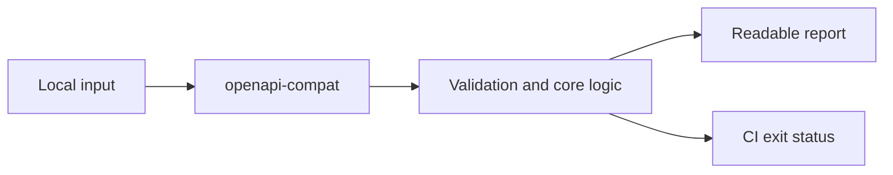

# openapi-compat

<div align="center">
  
  <br/>
  
  
  
</div>

> Compare two OpenAPI JSON documents and report removed operations and request fields that may break clients.

## Why it exists

A focused, inspectable starter for a real developer workflow. It favors explicit behavior, local execution, and small pieces that are easy to understand and extend.

## Features

- Detects removed paths and HTTP operations
- Flags removed parameters and required request properties
- Reports a machine-readable compatibility summary
- Works offline with OpenAPI documents in JSON format

## Architecture



## Requirements

- Python 3.10+ / standard library
- A terminal and a local checkout of this repository

## Quick start

```bash
python src/openapi_compat.py old.json new.json
```

## Example

```bash
python src/openapi_compat.py api-v1.json api-v2.json --json
```

## Project status and limitations

This repository contains an initial working implementation, not a production-certified product. Review the source and test it against your own fixtures before adopting it in critical workflows.

This first version compares a focused subset of OpenAPI JSON fields. It intentionally reports potential breaks conservatively.

## Roadmap

- [ ] Add YAML input through optional PyYAML
- [ ] Compare response schemas and enums
- [ ] Add severity policy configuration

## Contributing

Issues and pull requests are welcome. Include a small reproducible example for bug reports, keep changes focused, and add tests for new behavior. Do not submit secrets or private data.

## License

MIT. See [LICENSE](LICENSE). Third-party services or optional dependencies remain subject to their own terms.
